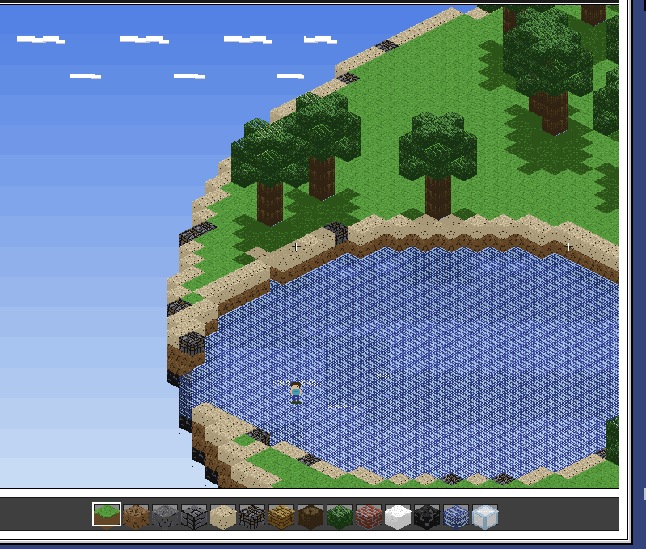
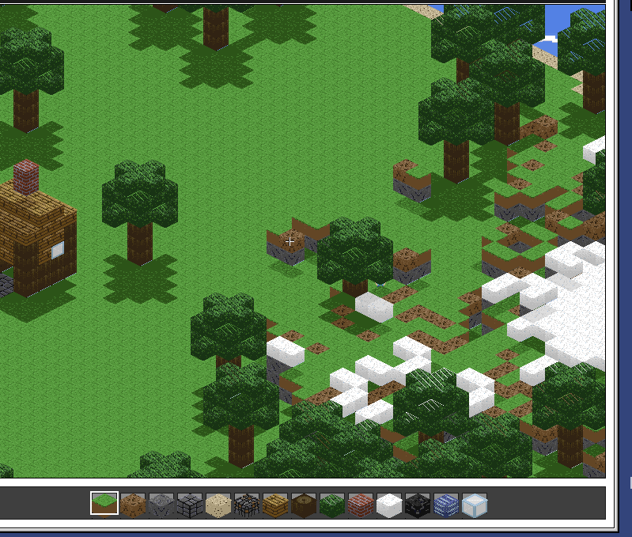

# MacCraft

An isometric block-building game for classic 68k Macintoshes.

MacCraft is a small Minecraft-inspired sandbox: a fixed 96 × 96 × 12 island of
grass, sand, water, wood and stone drawn as 32 × 16 isometric tiles, with a
village of four houses, a forest, a lake and a snow-capped hill. Blocks are
full cubes — a block of grass is one block of dirt with grass baked into its
top and its lip — and every face is textured and shaded by direction, with
ambient occlusion where faces crowd together and a cast shadow from anything
taller than the ground it stands on. It is written in C against the
classic Macintosh Toolbox and compiled with
[Retro68](https://github.com/autc04/Retro68). There is no 3D hardware and no
68020-only code: everything is integer 2D QuickDraw, so it runs on a Mac Plus
or SE as well as a Quadra.


<p align="center">
  
  
</p>

## Controls

| Action | Input |
| --- | --- |
| Walk | Arrow keys or W/A/S/D (hold to keep walking) |
| Walk into a house | Doorways are two blocks wide and two tall; walk at one and you go through |
| Swim | Walk into the lake: you float and can climb back out |
| Climb a step | Walk into a single block: one block is stepped up, two needs a jump and cannot be walked |
| Jump | Space |
| Place block | Click a tile's top face to stack, or its side face to build beside it |
| Mine block | Hold shift and the mouse button on a block until it breaks |
| Select block | Click a hotbar swatch, or press 1-9 |
| Cycle block | T |
| Recentre view | Walk: the camera follows when you near the edge of the view |
| New game | Cmd-N |
| Reset world | Game > Reset World |
| Quit | Cmd-Q (the world is saved) |

Fourteen block kinds are available; the hotbar shows them all and the selected
one is outlined. The world is saved when the application quits and restored on
the next launch; a save from an older build is discarded rather than resumed.

## Requirements

- System 7 or later on a 68000 (or better) Macintosh
- 1.5 MB of application memory; 2 MB preferred (the world is 108 KB on its own)
- No network, no extensions, no System 7.5 features

## Current state

- **World**: 96 × 96 × 12, generated at launch — a sand-ringed coast, a lake in
  the south-west, a village plateau in the middle, a forest belt and a
  snow-capped hill in the north-east.
- **Village**: four houses, each with a cobble sill, four courses of plank wall
  with log corners, a two-wide two-tall doorway with log jambs and a stone step,
  windows on both flanks, a pitched roof closed on every row, and a brick
  chimney on the ridge.
- **Trees**: four blocks of trunk with the crown above head height, so you can
  walk under the leaves; crowns are two wide frames, a 3×3 and a plus.
- **Rendering**: every face is a hand-authored 16 × 16 texture sheared onto its
  isometric quad, shaded one step per face direction (top 1.0, left 0.8, right
  0.6 in Minecraft's fixed sun) with ambient occlusion where blocks crowd a
  face. Water and leaves keep holes in their mask so the bed and the sky show
  through. Drawn in direct colour through the sprite layer; a full repaint of
  the play area is about 100 ticks on the emulated guest, and a camera pan while
  walking costs about one, because it scrolls the frame and repaints only the
  strip the shift uncovered.
- **HUD**: crosshair, the held block drawn at 2×, a hotbar of real block
  textures, and a status strip reading the block under the cursor, the block
  that would be placed, and the tile coordinates.
- **Sound**: a click on a swatch, place and break.

The pixel pipeline and the two QuickDraw facts it rests on are in
`docs/textures.md`.

## Building

The build runs inside the upstream Retro68 Docker image, so nothing needs to be
installed on the host beyond Docker:

```bash
docker run --rm -v "$PWD:/root/work" \
  -v "$HOME/Documents/SendToMacOS9/MPW/MPW-GM+PR+Final Updates/Interfaces&Libraries:/ial:ro" \
  -w /root/work \
  -e APP_VERSION_STR="$(git describe --tags --always --dirty)" \
  ghcr.io/autc04/retro68 bash -lc 'make build APP_NAME=MacCraft IAL_DIR=/ial'
```

The application is built against Apple's Universal Interfaces (required —
Retro68's bundled Multiversal set has no `Controls.h`, `Lists.h` or `Scrap.h`),
which the Makefile stages from `IAL_DIR`; the stock Retro68 image ships none, so
`IAL_DIR` must point at a copy and the command above mounts one. With a copy
somewhere else:
docker run --rm -v "$PWD:/root/work" \
  -v "$HOME/Documents/SendToMacOS9/MPW/MPW-GM+PR+Final Updates/Interfaces&Libraries:/ial:ro" \
  -w /root/work \
  -e APP_VERSION_STR="$(git describe --tags --always --dirty)" \
  ghcr.io/autc04/retro68 bash -lc 'make build APP_NAME=MacCraft IAL_DIR=/ial'
```

CI fetches the same interfaces from a pinned mirror of Apple's set into `ial/`
(gitignored). Output lands in `dist/`:

- `MacCraft.dsk` — bootable/disk image containing the application
- `MacCraft.bin` — raw application binary
- `MacCraft.APPL` — the application with its resource fork
- `MacCraft.ad` / `%MacCraft.ad` — the empty data fork and the AppleDouble file
  that carries the resource fork (what the `.sit` step uses)

With a local Retro68 build tree and a local interfaces copy, both can be
pointed at the host (defaults: `/Retro68-build` and the MPW path above):

```bash
make build APP_NAME=MacCraft RETRO68_PATH="$HOME/Projects/Retro68/build"
```

Other targets: `make run` (launch in Mini vMac through `LaunchAPPL -e minivmac`,
requires a configured `LaunchAPPL.cfg`), `make debug-build`, `make clean`,
`make format`, `make lint`.

### Tests

```bash
bash tests/host/run.sh
```

runs the Toolbox-free unit tests on the host with AddressSanitizer and UBSan:
world bounds, the isometric projection and picking, the face baker, the light
model, the island generator, the player's physics, and a walkability suite that
drives the real collision code through every doorway and under every tree. The emulator scenarios in
`tests/emulator/` drive a real SheepShaver guest and are run locally on macOS;
see `tests/emulator/README.md`.

## Download

Tagged builds are published on the
[Releases](https://github.com/yocontra/maccraft/releases) page. Each release
carries the `.dsk`, the `.bin` and a `.sit` StuffIt archive with the resource
fork intact — on a real Mac, download the `.sit` and unstuff it, then copy the
application to your boot disk. The `.dsk` is convenient for emulators
(Mini vMac, Basilisk II, SheepShaver).

## License

MIT — see [LICENSE](LICENSE).
