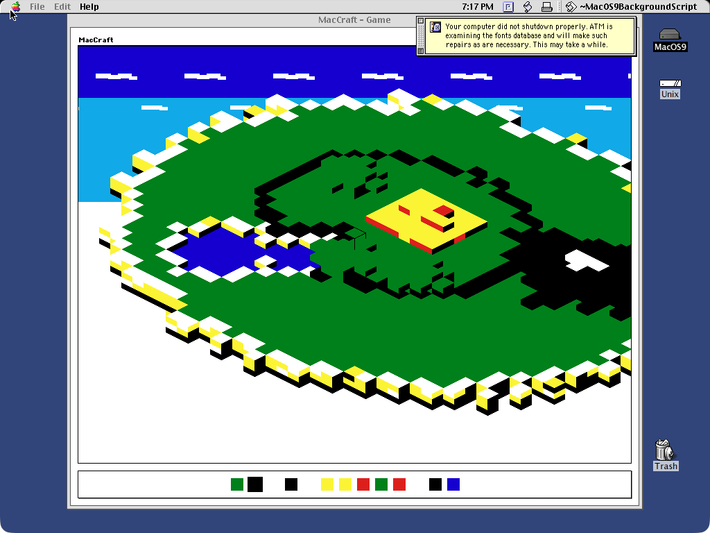

# MacCraft

An isometric block-building game for classic 68k Macintoshes.

MacCraft is a small Minecraft-inspired sandbox: a fixed 48 × 48 × 8 world of
dirt, stone and grass drawn as 32 × 16 isometric tiles, with place and remove
actions, camera panning and a three-swatch block selector. It is written in C
against the classic Macintosh Toolbox and compiled with
[Retro68](https://github.com/autc04/Retro68). There is no 3D hardware and no
68020-only code: everything is integer 2D QuickDraw, so it runs on a Mac Plus
or SE as well as a Quadra.



## Controls

| Action | Input |
| --- | --- |
| Walk | Arrow keys or W/A/S/D (hold to keep walking) |
| Jump | Space |
| Place block | Click a tile's top face to stack, or its side face to build beside it |
| Mine block | Hold shift and the mouse button on a block until it breaks |
| Select block | Click a hotbar swatch, or press 1-9 |
| Cycle block | T |
| Recentre view | Walk: the camera follows when you near the edge of the view |
| New game | Cmd-N |
| Reset world | Game > Reset World |
| Quit | Cmd-Q (the world is saved) |

Fourteen block kinds are available; the hotbar shows them all and the selected
one is outlined.

## Requirements

- System 7 or later on a 68000 (or better) Macintosh
- 768 KB of application memory; a 1 MB partition is comfortable
- No network, no extensions, no System 7.5 features

## Current state

The world is a hand-authored island — coast, sand shelf, lagoon, plateau, stone
ridge with snow, a plank hut and trees — rendered as 32x16 isometric tiles with
one shade per face (top 1.0, left 0.8, right 0.6, dimmed by neighbouring blocks),
face culling, a Minecraft-style cloud layer, and a selection wireframe on the
block under the middle of the view. Every face is textured: one patterned fill
whose ink is a highlight step of the block's colour, so a surface reads as
material rather than as a flat wash.

Every block face carries a hand-authored 16x16 texture, sheared onto its
isometric quad and shaded one step per face direction, drawn in direct colour.
A full repaint of the play area costs 25 ticks (0.42 s) on the emulated guest,
down from 67. The HUD is a crosshair, the held block drawn at 2x, and a hotbar of
real block textures. Everything has sound: a click on a swatch, place and break.
Clicks are picked on the surface you can see, not on the ground plane, so raised
terrain behaves. The profile and the pixel-pipeline findings are in
`docs/textures.md`.
See `docs/textures.md` for how the pixel pipeline works and the two QuickDraw
facts it rests on.

## Building

The build runs inside the upstream Retro68 Docker image, so nothing needs to be
installed on the host beyond Docker:

```bash
docker run --rm -v "$PWD:/root/work" \
  -v "$HOME/Documents/SendToMacOS9/MPW/MPW-GM+PR+Final Updates/Interfaces&Libraries:/ial:ro" \
  -w /root/work \
  -e APP_VERSION_STR="$(git describe --tags --always --dirty)" \
  ghcr.io/autc04/retro68 bash -lc 'make build APP_NAME=MacCraft IAL_DIR=/ial'
```

The application is built against Apple's Universal Interfaces (required —
Retro68's bundled Multiversal set has no `Controls.h`, `Lists.h` or `Scrap.h`),
which the Makefile stages from `IAL_DIR`; the stock Retro68 image ships none, so
`IAL_DIR` must point at a copy and the command above mounts one. With a copy
somewhere else:
docker run --rm -v "$PWD:/root/work" \
  -v "$HOME/Documents/SendToMacOS9/MPW/MPW-GM+PR+Final Updates/Interfaces&Libraries:/ial:ro" \
  -w /root/work \
  -e APP_VERSION_STR="$(git describe --tags --always --dirty)" \
  ghcr.io/autc04/retro68 bash -lc 'make build APP_NAME=MacCraft IAL_DIR=/ial'
```

CI fetches the same interfaces from a pinned mirror of Apple's set into `ial/`
(gitignored). Output lands in `dist/`:

- `MacCraft.dsk` — bootable/disk image containing the application
- `MacCraft.bin` — raw application binary
- `MacCraft.APPL` — the application with its resource fork
- `MacCraft.ad` / `%MacCraft.ad` — the empty data fork and the AppleDouble file
  that carries the resource fork (what the `.sit` step uses)

With a local Retro68 build tree and a local interfaces copy, both can be
pointed at the host (defaults: `/Retro68-build` and the MPW path above):

```bash
make build APP_NAME=MacCraft RETRO68_PATH="$HOME/Projects/Retro68/build"
```

Other targets: `make run` (launch in Mini vMac through `LaunchAPPL -e minivmac`,
requires a configured `LaunchAPPL.cfg`), `make debug-build`, `make clean`,
`make format`, `make lint`.

### Tests

```bash
bash tests/host/run.sh
```

runs the Toolbox-free unit tests (world bounds, isometric round-trip) on the
host with AddressSanitizer and UBSan. The emulator scenarios in
`tests/emulator/` drive a real SheepShaver guest and are run locally on macOS;
see `tests/emulator/README.md`.

## Download

Tagged builds are published on the
[Releases](https://github.com/yocontra/maccraft/releases) page. Each release
carries the `.dsk`, the `.bin` and a `.sit` StuffIt archive with the resource
fork intact — on a real Mac, download the `.sit` and unstuff it, then copy the
application to your boot disk. The `.dsk` is convenient for emulators
(Mini vMac, Basilisk II, SheepShaver).

## License

MIT — see [LICENSE](LICENSE).
